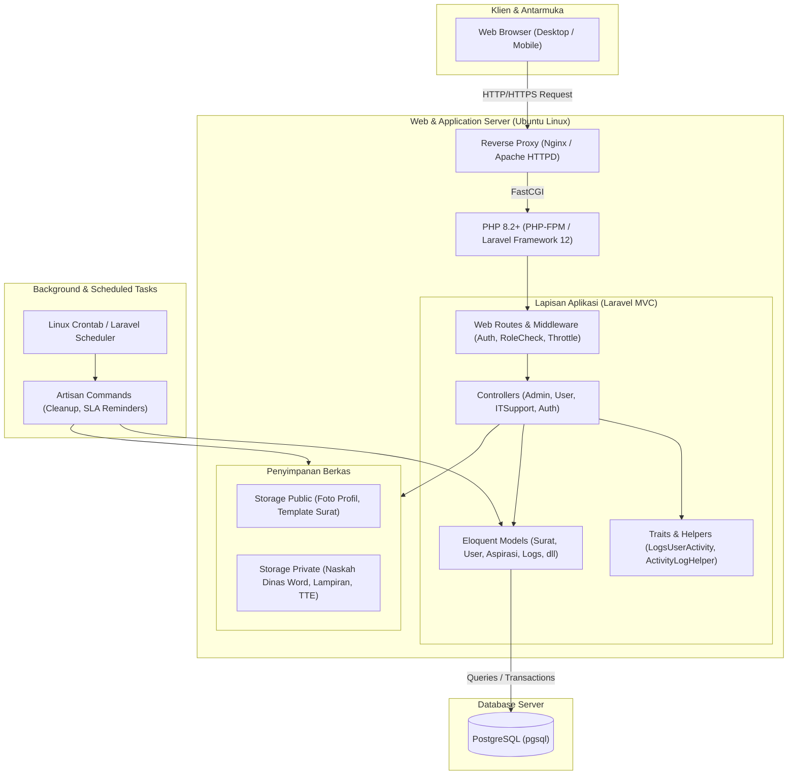

# 🏗️ Modul 01: Arsitektur & Teknologi Sistem
### Sistem Informasi Dashboard TU BP SUML

Dokumen ini menjelaskan arsitektur perangkat lunak, tumpukan teknologi (*technology stack*), pola desain, dan mekanisme keamanan yang diterapkan pada aplikasi **Dashboard TU BP SUML**.

---

## 1. Diagram Arsitektur Tingkat Tinggi (High-Level Architecture)

Aplikasi dibangun menggunakan pola arsitektur **Model-View-Controller (MVC)** berbasis framework **Laravel 12**, melayani lingkungan on-premise/LAN internal kantor BP SUML dengan arsitektur monolitik modern:



---

## 2. Rincian Teknologi (Tech Stack)

### A. Backend & Framework
- **PHP 8.2+**: Menggunakan fitur tipe data terdefinisi (`type hinting`), match expressions, readonly properties, dan performa JIT.
- **Laravel 12.x**: Kerangka kerja utama yang menyediakan routing, Eloquent ORM, CSRF protection, event handling, dan middleware.
- **Laravel Breeze 2.4**: Autentikasi dasar yang dikustomisasi untuk mendukung login NIP / Email, session tracking, dan multi-role.

### B. Library & Ekstensi Penting
- **`phpoffice/phpword` (^1.1)**: Digunakan untuk membaca, menganalisis, dan memanipulasi metadata dokumen Microsoft Word (`.docx`).
- **`maatwebsite/excel` (^3.1)**: Digunakan untuk pembuatan laporan rekapitulasi surat, log SLA, dan data pengguna dalam format spreadsheet Excel (`.xlsx`).
- **`chart.js`**: Pustaka visualisasi grafik di sisi browser untuk menampilkan statistik beban kerja persuratan, sebaran jenis surat, dan pemenuhan SLA.

### C. Database & Caching
- **PostgreSQL 14+ / 16+**: Menggunakan driver PDO PostgreSQL (`pgsql`) dengan keunggulan integritas relasional kuat, JSON/JSONB support untuk audit changes di `activity_logs`, serta indexing performa tinggi (B-Tree & Hash index).
- **Cache & Session**: Menggunakan driver database/file untuk menjaga konsistensi state sesi login di lingkungan jaringan tertutup.

---

## 3. Struktur Direktori Proyek

```
dashboard-tubpsuml/
├── app/
│   ├── Helpers/
│   │   └── ActivityLogHelper.php        # Helper pencatatan audit log otomatis
│   ├── Http/
│   │   ├── Controllers/
│   │   │   ├── Admin/                   # Controller area kerja Admin/Kasubbag TU/Kepala Balai
│   │   │   ├── Auth/                    # Autentikasi, login, reset password, switch akun
│   │   │   ├── User/                    # Controller area kerja Pegawai/Pengusul
│   │   │   └── ITSupportController.php  # Modul tiket kendala dan broadcast notifikasi
│   │   ├── Middleware/                  # Filter role, SLA check, role selection gate
│   │   └── Requests/                    # Form Request Validation
│   ├── Models/                          # Eloquent ORM Models
│   └── Traits/
│       └── LogsUserActivity.php         # Trait Eloquent untuk auto-audit log
├── config/                              # Berkas konfigurasi aplikasi & sistem
├── database/
│   ├── migrations/                      # Skema migrasi database berurutan
│   └── seeders/                         # Inisialisasi data awal (role, akun standar)
├── docs/                                # Direktori dokumentasi resmi (Anda berada di sini)
├── public/                              # Root web publik (assets, icons, entry point index.php)
├── resources/
│   └── views/                           # Template Blade (admin, user, auth, layout)
├── routes/
│   ├── web.php                          # Rute utama aplikasi web
│   ├── auth.php                         # Rute autentikasi Breeze
│   └── console.php                      # Rute scheduler & artisan background jobs
└── storage/
    └── app/
        ├── private/                     # Berkas terlindungi (dokumen surat rahasia, TTE)
        └── public/                      # Berkas statis publik (avatar, template surat)
```

---

## 4. Mekanisme Keamanan Khusus (Security Highlights)

### A. Blind Indexing untuk NIP Pegawai (`nip_hash`)
Untuk menjamin privasi NIP pegawai di database tanpa kehilangan kemampuan pencarian cepat (*equality lookup*):
- NIP disimpan dalam kolom `nip` (dapat dienkripsi).
- Kolom pendamping `nip_hash` diisi menggunakan HMAC SHA-256 yang diturunkan dari `APP_KEY`.
- Ketika pegawai login menggunakan NIP, sistem melakukan pencarian via `nip_hash`, mencegah eksploitasi kebocoran database teks terbuka.

### B. Proteksi Tanda Tangan Elektronik (TTE / Digital Signature)
- Gambar tanda tangan basah yang di-scan disimpan di direktori privat (`storage/app/private/tte/`), bukan di direktori publik.
- Admin atau user lain tidak dapat mengakses URL file TTE secara langsung tanpa izin autentikasi yang sah.
- Setiap aksi pembubuhan TTE pada dokumen Tahap 6 dilindungi dengan validasi **PIN Terenkripsi** (`signature_pin`).

### C. Manajemen Sesi dan Pembatalan Sesi (Revoke Session)
- Fitur multi-session tracking mencatat ID sesi, IP Address, dan User Agent per perangkat.
- Pengguna maupun Admin Kasubbag TU dapat melakukan *revoke* (pencabutan sesi paksa) pada perangkat yang mencurigakan atau saat terjadi reset kredensial.

### D. Rate Limiting (Throttle)
Untuk menghindari spam atau serangan denial-of-service di jaringan lokal:
- Pengajuan surat: dibatasi maksimal 5 kali per menit per user (`throttle:5,1`).
- Pengiriman aspirasi: dibatasi maksimal 10 kali per menit (`throttle:10,1`).
- Upaya login dan permohonan role khusus IT: diproteksi dengan limit ketat.

---

## 5. Sistem Notifikasi & Pembaruan Data Realtime

Sistem mengimplementasikan dua jalur komunikasi status:

1. **Server-Sent Events (SSE)** via `NotificationStreamController`:
   - Mengalirkan event ke browser pegawai dan admin secara satu arah (*one-way stream*).
   - Efisien dan tidak membebani memori server layaknya WebSocket tradisional di server LAN.
2. **Polling API Cadangan** via `NotificationApiController` & `live-data`:
   - Jika koneksi SSE terputus karena konfigurasi firewall atau proxy LAN, frontend secara mulus berganti ke mekanisme interval polling periodik (setiap 30-60 detik) untuk memeriksa pembaruan tahap surat dan badge lonceng notifikasi.

---

## 6. Audit Trail & Pencatatan Log Aktivitas

Setiap tindakan kritis (pembuatan surat, persetujuan, penolakan, perubahan berkas, pembubuhan nomor, reset password) secara otomatis dicatat ke dalam tabel `activity_logs` menggunakan trait `LogsUserActivity`. 

Atribut yang direkam mencakup:
- ID Pengguna pelaksana
- Jenis aksi (`create`, `update`, `approve`, `reject`, `delete`, `download`, `login`, `logout`)
- Model & ID data yang dimodifikasi
- Alamat IP dan User Agent browser
- Snapshot perubahan data (*diff json* sebelum vs sesudah)
