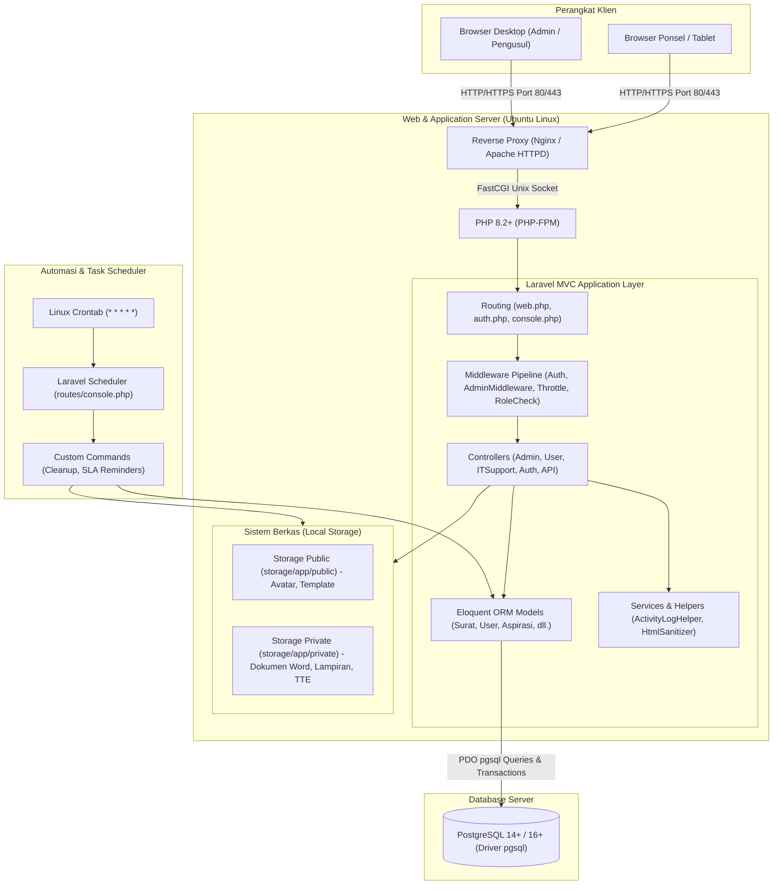

# 🏛️ Arsitektur Sistem & Pola Desain MVC
### Sistem Informasi Dashboard TU BP SUML

Dokumen ini menjelaskan arsitektur perangkat lunak tingkat tinggi (*high-level architecture*), pola arsitektur **Model-View-Controller (MVC)**, alur interaksi request-response, dan batasan lingkungan infrastruktur on-premise pada **Dashboard TU BP SUML**.

---

## 1. Diagram Arsitektur Tingkat Tinggi (High-Level Architecture)

Aplikasi dibangun menggunakan pola arsitektur monolitik modern berbasis **Laravel 12** yang beroperasi di lingkungan Local Area Network (LAN) / Intranet kantor BP SUML:

---

## 2. Pola Arsitektur Model-View-Controller (MVC)

Sistem mengadopsi standar MVC Laravel 12 dengan pemisahan tanggung jawab yang ketat:

### A. Model (`app/Models/`)
- Bertanggung jawab atas integritas data, relasi antar entitas, casting tipe data, query scope, dan event lifecycle model (`creating`, `saving`).
- Setiap model utama mengimplementasikan trait `LogsUserActivity` untuk mencatat riwayat perubahan secara otomatis.
- Contoh model:
  - [`Surat`](file:///c:/xampp/htdocs/dashboard-tubpsuml/app/Models/Surat.php): Mengelola seluruh metadata persuratan, perhitungan sisa jam SLA, status revisi, dan relasi 10 tahapan.
  - [`User`](file:///c:/xampp/htdocs/dashboard-tubpsuml/app/Models/User.php): Mengelola otentikasi, blind index hash NIP, otorisasi peran, dan PIN Tanda Tangan Elektronik.
  - [`SuratTahapan`](file:///c:/xampp/htdocs/dashboard-tubpsuml/app/Models/SuratTahapan.php): Mencatat kronologis pemrosesan dari tahap 1 hingga tahap 10.
  - [`Aspirasi`](file:///c:/xampp/htdocs/dashboard-tubpsuml/app/Models/Aspirasi.php): Mengelola keluhan, saran, dan pertanyaan pengguna.
  - [`ActivityLog`](file:///c:/xampp/htdocs/dashboard-tubpsuml/app/Models/ActivityLog.php): Menyimpan log audit trail komprehensif.

### B. View (`resources/views/`)
- Menggunakan templating engine **Blade** yang memisahkan antarmuka berdasarkan konteks pengguna:
  - `resources/views/admin/`: Panel kerja Arsiparis, Kasubbag TU, dan Kepala Balai.
  - `resources/views/user/`: Panel kerja Pegawai Pengusul (pengajuan naskah dinas, tracking surat, aspirasi, direktori pegawai).
  - `resources/views/itsupport/`: Panel teknis IT Support untuk bug report dan broadcast.
  - `resources/views/auth/`: Formulir autentikasi, verifikasi, dan reset password.
  - `resources/views/errors/`: Halaman status error ramah pengguna (403, 404, 419, 429, 500, 503).

### C. Controller (`app/Http/Controllers/`)
- Menerima HTTP request, melakukan validasi data via Form Request / Controller validation, mengeksekusi logika bisnis, memanggil model, dan mengembalikan respon berupa tampilan Blade, file stream binary, atau payload JSON.
- Terbagi dalam namespace:
  - `App\Http\Controllers\Admin`: Penanganan proses administratif dan persetujuan.
  - `App\Http\Controllers\User`: Penanganan pengajuan surat dan monitoring pegawai.
  - `App\Http\Controllers\Auth`: Siklus autentikasi Breeze & token-based switch account.
  - `App\Http\Controllers`: Modul publik (Welcome, Verifikasi QR publik, Stream SSE).

---

## 3. Alur Siklus Hidup Request (Request Lifecycle)

1. **Incoming Request**: Klien mengirimkan request ke web server Nginx.
2. **Entry Point**: Request diteruskan ke `public/index.php`.
3. **HTTP Kernel & Middleware Pipeline**:
   - `SecurityHeaders`: Membubuhkan header keamanan HTTP.
   - `auth`: Memeriksa apakah session user valid.
   - `admin`: Memeriksa apakah user berhak mengakses grup route `/Admin`.
   - `admin.role.check`: Memastikan admin telah melewati pemilihan peran aktif.
   - `throttle`: Membatasi frekuensi request untuk mencegah spam / brute-force.
4. **Controller Execution**: Controller memproses parameter, berinteraksi dengan model dan disk storage.
5. **Database Transaction**: Perubahan data persuratan dan log audit dijalankan dalam transaksi terisolasi.
6. **Response Generation**: Menghasilkan HTML Blade atau unduhan file terproteksi.

