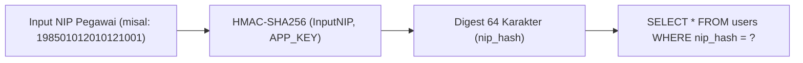

# 🔒 Mekanisme Keamanan & Privasi Data
### Sistem Informasi Dashboard TU BP SUML

Dokumen ini mendokumentasikan seluruh lapisan perlindungan keamanan informasi, proteksi data identitas pegawai, keamanan tanda tangan digital, manajemen sesi terdistribusi, serta pencegahan penyalahgunaan sistem (*abuse mitigation*).

---

## 1. Perlindungan NIP Pegawai dengan Blind Index Hashing

Identitas Nomor Induk Pegawai (NIP) merupakan data privat sensitif. Untuk mencegah kebocoran plaintext NIP apabila database diekspor atau disusupi tanpa mengorbankan kecepatan pencarian (*equality lookup* saat login):



### Implementasi pada Model `User`:
- Kolom `nip` menyimpan nomor pegawai.
- Kolom `nip_hash` bertipe `CHAR(64)` memiliki index unik (*unique index*).
- Pada saat event Eloquent `saving`:
  ```php
  static::saving(function ($model) {
      if ($model->isDirty('nip')) {
          $model->nip_hash = $model->nip ? self::hashNip($model->nip) : null;
      }
  });
  ```
- Fungsi `hashNip()` menggunakan fungsi kriptografi satu arah:
  ```php
  public static function hashNip(string $nip): string
  {
      return hash_hmac('sha256', $nip, config('app.key'));
  }
  ```
- **Keunggulan**:
  1. *Deterministik*: Nilai hash selalu sama untuk NIP yang sama jika `APP_KEY` tetap, memungkinkan pencarian $O(1)$.
  2. *Anti-Reverse*: Tanpa `APP_KEY`, penyerang yang mencuri database tidak dapat mendekripsi kembali NIP pegawai.

---

## 2. Keamanan Tanda Tangan Elektronik (TTE / Digital Signature)

Pembubuhan Tanda Tangan Elektronik pada Tahap 6 memerlukan kontrol keamanan ganda (*two-factor authority*):
1. **Penyimpanan Terisolasi**: Berkas scan tanda tangan disimpan di `storage/app/private/tte/` yang tidak dapat diakses melalui URL web langsung.
2. **Validasi PIN Terenkripsi (`signature_pin`)**:
   - Kepala Balai wajib mendaftarkan PIN 6 digit pada halaman profil.
   - PIN disimpan dalam bentuk hash terenkripsi (Bcrypt / Hash::make).
   - Saat Kepala Balai menyetujui Tahap 6 naskah dinas, sistem memvalidasi PIN yang diinput dengan `Hash::check($request->pin, $user->signature_pin)`.
   - Tanpa PIN yang valid, pembubuhan tanda tangan dan penerbitan stempel QR akan ditolak sistem.

---

## 3. Manajemen Multi-Sesi & Pencabutan Sesi (Session Revocation)

Sistem melacak sesi login aktif per pengguna melalui tabel `sessions` di basis data:
- Pengguna dapat melihat daftar perangkat aktif (IP Address, Jenis Browser, dan Timestamp Terakhir Aktif) di menu **Profil Pengguna**.
- **Fitur Revoke**:
  - `revokeSession($sessionId)`: Mengeluarkan perangkat tertentu yang dicurigai.
  - `revokeAllOtherSessions()`: Mengeluarkan seluruh sesi aktif di perangkat lain selain perangkat yang sedang digunakan saat ini.
- Kasubbag TU dapat mencabut sesi login pegawai saat melakukan reset password darurat.

---

## 4. Pembatasan Laju Akses (Rate Limiting / Route Throttling)

Untuk mencegah serangan *brute force*, spamming, dan kelebihan beban di jaringan lokal kantor:

| Endpoint Rute | Batasan (Throttle) | Tujuan Keamanan |
|---|---|---|
| `POST /login` | `5 request / 1 menit` | Mencegah tebak kata sandi / brute-force akun |
| `POST /register` | `throttle:registration` | Membatasi pendaftaran liar |
| `POST /surat/ajukan` | `5 submission / 1 menit` | Menghindari duplikasi unggah naskah yang sama |
| `PATCH /surat/{surat}` | `5 pembaruan / 1 menit` | Membatasi spam update draf |
| `POST /surat/{surat}/reupload` | `5 pengunggahan / 1 menit`| Membatasi beban upload file ke disk server |
| `POST /aspirasi` | `10 request / 1 menit` | Mencegah bot spam formulir saran/keluhan |
| `GET /become-it-support` | `3 request / 1 menit` | Memproteksi rute aktivasi peran teknis |
| `POST /auth/switch-account` | `10 request / 1 menit` | Mencegah token scanning untuk ganti akun |

---

## 5. Sanitasi Masukan & Proteksi XSS (Cross-Site Scripting)

Seluruh input teks bebas dari pengguna (seperti `catatan_pengusul`, `catatan_verifikator`, perihal surat, dan isi aspirasi) disaring menggunakan service `App\Services\HtmlSanitizer` sebelum disimpan ke database:
- Menghapus tag berbahaya (`<script>`, `<iframe>`, `onload=`, `javascript:`).
- Mencegah injeksi kode berbahaya saat data ditampilkan kembali di layar admin atau pengusul.
- Blade templating secara default melakukan escaping otomatis menggunakan sintaks `{{ $variabel }}`.

