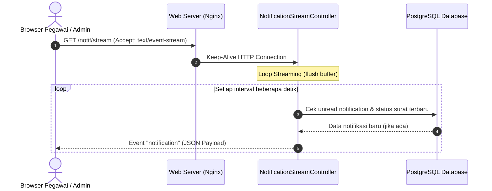

# ⚡ Komunikasi Realtime & Sistem Event
### Sistem Informasi Dashboard TU BP SUML

Dokumen ini menjelaskan rancangan sistem pembaruan data secara *real-time*, implementasi **Server-Sent Events (SSE)**, mekanisme *fallback polling API*, serta arsitektur notifikasi internal di lingkungan jaringan lokal kantor BP SUML.

---

## 1. Tantangan Lingkungan Jaringan Lokal (LAN On-Premise)

Di server intranet BP SUML:
- Penggunaan server WebSocket terpisah (seperti Laravel Reverb atau Soketi yang membutuhkan port khusus misal 8080/6001) kerap terkendala firewall internal dan konfigurasi reverse-proxy LAN.
- Karena itu, sistem dirancang dengan pendekatan dual-channel:
  1. **Primary**: **Server-Sent Events (SSE)** melalui HTTP standar port 80/443.
  2. **Fallback**: **Polling HTTP Ringan** (setiap 30–60 detik).

---

## 2. Implementasi Server-Sent Events (SSE)

Controller `NotificationStreamController` melayani koneksi streaming satu arah dari server ke browser:



### Karakteristik Teknis SSE:
- **Header Khusus**:
  ```http
  Content-Type: text/event-stream
  Cache-Control: no-cache
  X-Accel-Buffering: no
  ```
- `X-Accel-Buffering: no` wajib disertakan agar reverse-proxy Nginx tidak menahan (*buffer*) paket data, sehingga pesan langsung tiba di peramban klien secara instan.
- Sangat hemat sumber daya CPU dan memori dibanding socket dua arah.

---

## 3. Mekanisme Polling Cadangan (Fallback Polling)

Apabila browser klien tidak mendukung EventSource atau koneksi SSE terputus karena batas waktu proxy:
- JavaScript di klien secara otomatis mendeteksi kegagalan koneksi (`onerror`).
- Sistem beralih ke interval polling via route:
  - `GET /notif/poll`: Mengambil daftar notifikasi terbaru yang belum dibaca (`unreadCount`).
  - `GET /dashboard/live-data` & `GET /Admin/Dashboard/live-data`: Memperbarui metrik antrean surat, jumlah surat proses, dan SLA tanpa memuat ulang seluruh halaman (*no full-page reload*).

---

## 4. Arsitektur Notifikasi Internal Sistem

Aplikasi menggunakan framework notifikasi bawaan Laravel yang disimpan pada tabel `notifications`:

1. **`SuratStatusNotification`**: Dikirimkan kepada pengusul ketika naskah dinasnya berpindah tahap, disetujui, atau diselesaikan.
2. **`SuratDiprosesNotification`**: Dikirimkan kepada verifikator (Arsiparis, Kasubbag TU, atau Kepala Balai) ketika ada naskah dinas baru yang masuk ke antrean tugas mereka.
3. **`FileRevisiNotification`**: Dikirimkan kepada verifikator ketika pengusul telah mengunggah naskah perbaikan (`.docx`) pasca penolakan.

### Aksi pada Notifikasi:
- Tandai satu dibaca: `POST /notif/read/{id}`
- Tandai semua dibaca: `POST /notif/read-all`
- Hapus satu notifikasi: `POST /notif/delete/{id}`
- Hapus seluruh riwayat notifikasi: `POST /notif/delete-all`

