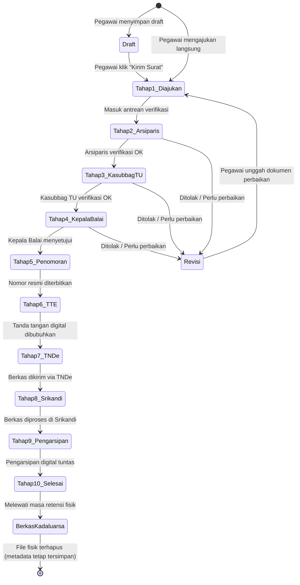
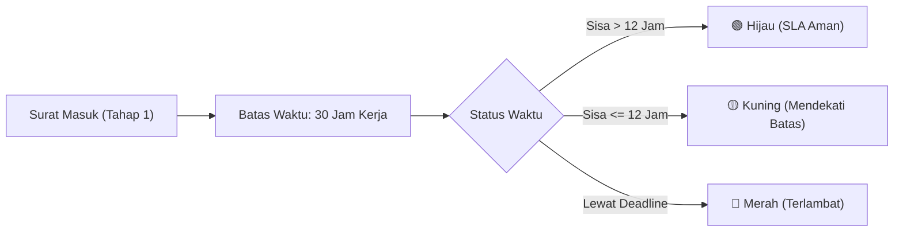

# 📋 Modul 02: Alur & Proses Bisnis Persuratan
### Sistem Informasi Dashboard TU BP SUML

Dokumen ini menguraikan seluruh siklus hidup surat, diagram alur 10 tahap pemrosesan naskah dinas, mekanisme Service Level Agreement (SLA), tata kelola revisi, hingga verifikasi QR code publik.

---

## 1. Diagram Siklus Hidup Surat (Lifecycle State Diagram)

---

## 2. Rincian 10 Tahap Pemrosesan Naskah Dinas

Setiap surat dinas yang diajukan ke dalam sistem secara otomatis melewati 10 tahapan berjenjang standar tata persuratan instansi:

| No | Nama Tahapan | Penanggung Jawab | Deskripsi Aktivitas |
|:---:|---|---|---|
| **1** | **Usulan Diajukan** | Pegawai Pengusul (`user`) | Pegawai mengunggah naskah format `.docx`, mengisi metadata (jenis, sifat, tujuan, catatan pengusul), dan melampirkan berkas pendukung (PDF/ZIP). |
| **2** | **Verifikasi Arsiparis** | Tim Arsiparis (`admin_aspirasi`) | Memeriksa format tata naskah dinas, kesesuaian template, ejaan, tata letak, dan kelengkapan dokumen pendukung. |
| **3** | **Verifikasi Kasubbag TU** | Kasubbag TU (`admin_kasubbag_tu`) | Melakukan telaah administratif lanjutan, validasi substansi kedinasan, urgensi, dan memberikan catatan telaah sebelum diteruskan ke pimpinan. |
| **4** | **Persetujuan Kepala Balai** | Kepala Balai (`admin_kepala_balai`) | Pimpinan tertinggi memeriksa perihal surat dan memberikan keputusan akhir: **Disetujui** atau **Ditolak/Revisi**. |
| **5** | **Penomoran Surat** | Petugas Administrasi / Arsiparis | Membubuhkan Nomor Surat Resmi dan Tanggal Surat sesuai buku agenda penomoran dinas BP SUML. |
| **6** | **Tanda Tangan (DS)** | Kepala Balai (`admin_kepala_balai`) | Pembubuhan Tanda Tangan Elektronik (TTE / Digital Signature) pada lembar naskah resmi menggunakan otorisasi PIN privat. |
| **7** | **Pengiriman via TNDe** | Tata Usaha / Admin | Pengiriman surat elektronik keluar melalui saluran aplikasi Tata Naskah Dinas Elektronik (TNDe). |
| **8** | **Pengiriman via Srikandi** | Tata Usaha / Admin | Distribusi atau pencatatan naskah dinas melalui platform persuratan nasional **Srikandi**. |
| **9** | **Pengarsipan** | Arsiparis (`admin_aspirasi`) | Berkas surat yang telah bertanda tangan dan bernomor resmi diarsipkan ke dalam basis data digital dan folder arsiparis. |
| **10**| **Follow Up / Selesai** | Admin & Pengusul | Surat dinyatakan tuntas. Pengusul dapat mengunduh dokumen akhir yang sah dan memberikan penilaian (rating kepuasan layanan 1-5 bintang). |

---

## 3. Aturan & Perhitungan SLA (Service Level Agreement)

Sistem menerapkan SLA terintegrasi untuk menjamin kecepatan dan kepatuhan pelayanan naskah dinas:

### A. Parameter Perhitungan Jam Kerja (Working Hours)
- **Target SLA**: Standar pemrosesan **30 Jam Kerja** sejak surat diajukan hingga tuntas.
- **Hari Kerja Aktif**: Senin s/d Jumat.
- **Jam Operasional**: Pukul 07.00 s/d 17.00 WIB (10 jam per hari kerja).
- **Sabtu, Minggu, dan Hari Libur Nasional**: Jam kerja dijeda (*paused*), sehingga timer deadline SLA tidak berkurang saat kantor libur.

### B. Indikator Warna SLA di Tampilan Dashboard
1. **Hijau (🟢)**: Sisa waktu pemrosesan aman (lebih dari 12 jam kerja).
2. **Kuning (🟡)**: Peringatan batas waktu mendekati akhir (sisa $\le$ 12 jam kerja).
3. **Merah (🔴)**: Surat telah melewati batas waktu SLA (*overdue*).

### C. Alasan Keterlambatan (*Overtime Justification*)
Apabila surat mengalami keterlambatan hingga berwarna merah, admin wajib memilih alasan keterlambatan sebelum dapat memproses atau menyelesaikan surat:
- *Volume surat tinggi*
- *Pejabat sedang dinas luar*
- *Kendala teknis sistem*
- *Menunggu konfirmasi pihak terkait*
- *Hari Libur/Tanggal Merah*
- *Banyak data masuk*
- *Lainnya (dilengkapi catatan tertulis)*

Data keterlambatan ini diakumulasikan secara otomatis ke dalam **Laporan Kinerja SLA** untuk evaluasi bulanan pimpinan.

---

## 4. Alur Penolakan & Revisi Naskah Dinas

Jika dalam proses verifikasi (di Tahap 2, 3, atau 4) ditemukan ketidaksesuaian dokumen:
1. **Admin Memilih "Tolak / Minta Revisi"**:
   - Admin wajib mengisi **Catatan Alasan Penolakan** (misal: "Lampiran belum ditandatangani basah" atau "Perbaiki format perihal").
   - Status surat berubah menjadi `ditolak` atau `revisi`.
2. **Notifikasi ke Pengusul**:
   - Pengusul menerima notifikasi realtime berisi catatan perbaikan dari verifikator.
3. **Pengunggahan Dokumen Perbaikan**:
   - Pada halaman detail surat, tombol *"Unggah Revisi Dokumen"* akan aktif bagi pengusul.
   - Pengusul mengunggah file `.docx` baru atau file lampiran yang telah diperbaiki.
   - Kolom `revisi_count` akan otomatis bertambah 1.
   - Status surat kembali ke antrean verifikasi (`proses`) dengan riwayat revisi yang tercatat transparan.

---

## 5. Kebijakan Retensi Berkas Fisik & Purge

Untuk mengoptimalkan ruang penyimpanan (*disk space*) server lokal kantor:
- **Pembersihan Otomatis**: Berkas naskah Word dan lampiran fisik yang telah berstatus `selesai` memiliki masa aktif (*file_expires_at*). Job cron harian akan menghapus berkas fisik yang telah melewati batas kedaluwarsa.
- **Retensi Metadata**: Meskipun berkas fisik `.docx` dihapus dari harddisk server, **catatan riwayat, nomor surat, tanggal persetujuan, log verifikator, dan metadata surat tetap tersimpan selamanya di database**.
- **Purge Mandiri**: Admin atau pengusul memiliki opsi tombol *"Bersihkan File Fisik"* pada surat yang sudah tuntas untuk segera membebaskan kapasitas storage server.

---

## 6. Verifikasi Publik Berbasis QR Code & UUID

Setiap naskah surat resmi yang diterbitkan dilengkapi tautan verifikasi publik:
- **Tautan Verifikasi**: `http://<domain-atau-ip-kantor>/v/{uuid}`
- **Fungsi**: Memungkinkan pihak eksternal atau penerima surat memindai kode QR pada dokumen cetak untuk mengonfirmasi keaslian dokumen tanpa perlu login ke sistem.
- **Informasi yang Ditampilkan**:
  - Nomor Surat Resmi dan Tanggal Terbit
  - Judul / Perihal Naskah
  - Pejabat Penandatangan
  - Status Otentisitas: **"Dokumen Resmi Terverifikasi BP SUML"**
