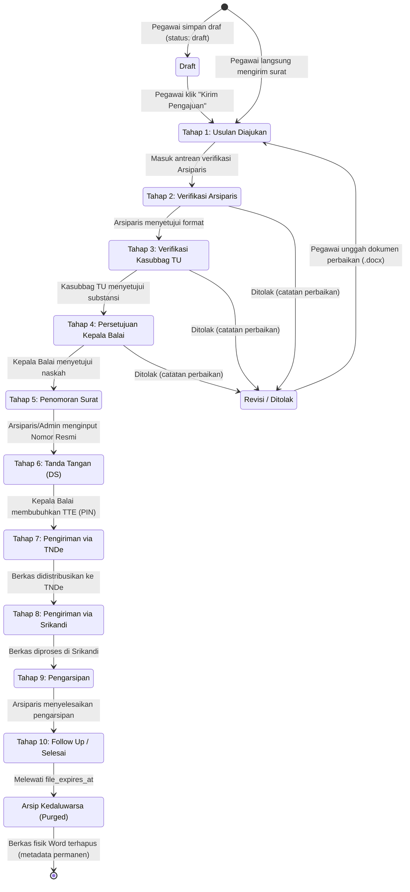

# 🔄 Siklus Hidup & 10 Tahapan Pemrosesan Naskah Dinas
### Sistem Informasi Dashboard TU BP SUML

Dokumen ini menguraikan seluruh siklus hidup surat dari saat diinisiasi oleh pegawai hingga selesai diarsipkan, diagram status (*state diagram*), serta rincian peran pada masing-masing dari 10 tahapan tata persuratan.

---

## 1. Diagram Status Siklus Hidup Surat (Lifecycle State Diagram)

---

## 2. Rincian Tabel 10 Tahapan Naskah Dinas

Setiap naskah surat dinas terikat dengan relasi tabel `surat_tahapans` yang dibuat otomatis saat inisialisasi (`initTahapan()`):

| No | Nama Tahap Resmi (`nama_tahap`) | Aktor Pelaksana | Tanggung Jawab & Ketentuan |
|:---:|---|---|---|
| **1** | **Usulan Diajukan** | Pegawai Pengusul (`user`) | Mengisi formulir metadata naskah dinas, mengunggah draf Word (`.docx`), dan lampiran pendukung. |
| **2** | **Verifikasi Arsiparis** | Arsiparis (`admin_aspirasi`) | Memeriksa format tata naskah dinas, kepatuhan template kedinasan, tata bahasa, dan lampiran. |
| **3** | **Verifikasi Kasubbag TU** | Kasubbag TU (`admin_kasubbag_tu`) | Melakukan telaah administratif lanjutan, validasi substansi tugas, urgensi, dan memberikan paraf persetujuan. |
| **4** | **Persetujuan Kepala Balai** | Kepala Balai (`admin_kepala_balai`) | Pejabat tertinggi menelaah naskah. Memberikan keputusan persetujuan naskah atau mengembalikan revisi. |
| **5** | **Penomoran Surat** | Petugas Administrasi / Arsiparis | Membubuhkan Nomor Surat Resmi dan Tanggal Resmi sesuai buku agenda persuratan BP SUML. |
| **6** | **Tanda Tangan (DS)** | Kepala Balai (`admin_kepala_balai`) | Pembubuhan Tanda Tangan Elektronik (*Digital Signature*) dengan memvalidasi PIN keamanan rahasia. |
| **7** | **Pengiriman via TNDe** | Tim Administrasi TU | Melakukan input dan ekspedisi berkas melalui aplikasi Tata Naskah Dinas Elektronik (TNDe). |
| **8** | **Pengiriman via Srikandi** | Tim Administrasi TU | Melakukan pencatatan atau pengiriman naskah ke platform kearsipan nasional Srikandi. |
| **9** | **Pengarsipan** | Arsiparis (`admin_aspirasi`) | Menyimpan naskah yang telah sah ke dalam lemari arsip digital instansi. |
| **10**| **Follow Up / Selesai** | Admin & Pengusul | Surat berstatus `selesai`. Pengusul dapat mengunduh berkas final dan memberikan rating kepuasan layanan (1–5 bintang). |

---

## 3. Status Utama Surat (`status` Enum)

Tabel `surats` mencatat status naskah dengan variasi nilai enum berikut:
1. `draft`: Naskah disimpan oleh pengusul dan belum masuk ke antrean verifikasi.
2. `proses`: Naskah sedang aktif berjalan di salah satu tahapan verifikasi (tahap 1 s/d 9).
3. `revisi`: Naskah dikembalikan oleh verifikator dan menunggu pengusul mengunggah berkas perbaikan.
4. `revisi_admin`: Perbaikan internal antar verifikator/admin.
5. `selesai`: Seluruh 10 tahapan telah tuntas diselesaikan.
6. `ditolak`: Naskah dinyatakan ditolak secara definitif atau dihentikan prosesnya.

