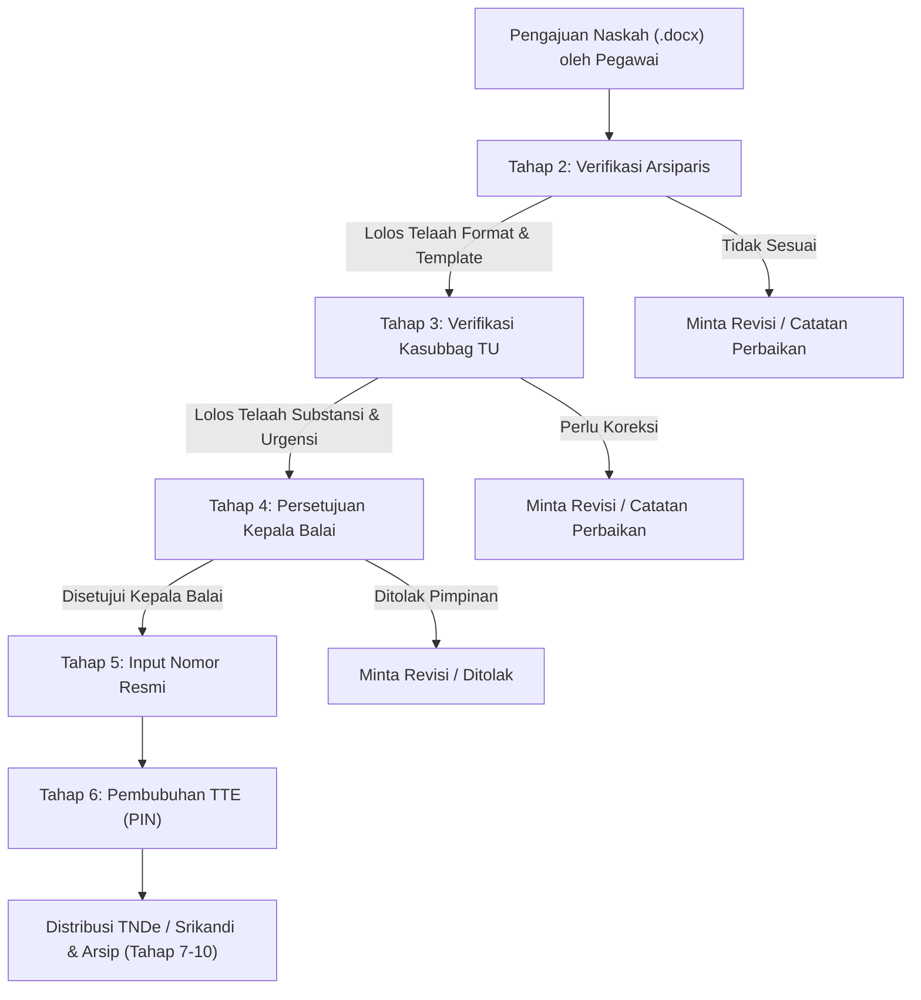

# 👥 Verifikasi Berjenjang & Otorisasi Persetujuan
### Sistem Informasi Dashboard TU BP SUML

Dokumen ini mendetailkan alur verifikasi bertingkat (*multi-level approval*), peran masing-masing verifikator, filter antrean tugas dinamis, serta mekanisme pengambilan keputusan pada **Dashboard TU BP SUML**.

---

## 1. Konsep Verifikasi Berjenjang

Untuk menjamin kualitas redaksional, validitas hukum, dan ketepatan tata naskah dinas pemerintah, surat yang diajukan tidak dapat langsung ditandatangani oleh pimpinan tanpa melalui telaah berjenjang:



---

## 2. Filter Antrean Tugas Berdasarkan Peran (Smart Queue)

Pada controller `App\Http\Controllers\Admin\SuratController`, antrean surat (`/Admin/Surat` atau `Antrian Surat`) secara cerdas hanya menampilkan surat-surat yang menjadi tanggung jawab role yang sedang aktif:

```php
// Potongan logika query filter antrean berdasarkan role:
if ($isAntrian && $admin) {
    if ($admin->role === 'admin_aspirasi') {
        // Arsiparis menangani tahap 2 (format) dan tahap 5 ke atas (penomoran, TNDe, Srikandi, arsip)
        $query->where(function ($q) {
            $q->where('tahap_sekarang', 2)
              ->orWhere('tahap_sekarang', '>=', 5);
        });
    } elseif ($admin->role === 'admin_kasubbag_tu') {
        // Kasubbag TU fokus pada tahap 3 (telaah substansi tata usaha)
        $query->where('tahap_sekarang', 3);
    } elseif ($admin->role === 'admin_kepala_balai') {
        // Kepala Balai fokus pada tahap 4 (persetujuan naskah)
        $query->where('tahap_sekarang', 4);
    }
}
```

*Catatan: Pada halaman "Semua Surat", "Surat Selesai", atau saat mengekspor laporan Excel, seluruh tingkatan admin memiliki visibilitas penuh untuk memantau data secara agregat.*

---

## 3. Method Pemeriksaan Otoritas pada Model `User`

Untuk mencegah verifikator melompati tahapan di luar kewenangannya, model `User` menyediakan method `canApproveTahap(int $tahap)`:

```php
public function canApproveTahap(int $tahap): bool
{
    return match ($this->role) {
        'admin_aspirasi'    => $tahap === 2 || $tahap >= 5,
        'admin_kasubbag_tu' => $tahap === 3,
        'admin_kepala_balai'=> $tahap === 4,
        'admin'             => true, // Superadmin sistem memiliki hak bypass penuh
        default             => false,
    };
}
```

---

## 4. Prosedur Eksekusi Persetujuan (`setujui`)

Saat tombol hijau **"Setujui Tahap Ini"** diklik pada antarmuka admin:
1. Sistem memverifikasi kecocokan role pengguna dengan tahapan aktif saat ini (`canApproveTahap()`).
2. Baris `surat_tahapans` untuk tahapan saat ini ditandai:
   - `status = 'selesai'`
   - `diproses_oleh = Auth::id()`
   - `selesai_pada = now()`
   - `catatan = $request->catatan` (opsional)
3. Jika surat masih berada pada tahap 1 s/d 9:
   - Kolom `tahap_sekarang` di tabel `surats` bertambah $+1$.
   - Baris tahapan berikutnya diubah statusnya menjadi `'proses'`.
4. Jika surat berada pada tahap 10:
   - Status surat berubah menjadi `'selesai'`.
   - Mengisi `disetujui_pada = now()`.
   - Mengeset waktu kedaluwarsa berkas fisik (`file_expires_at`).
5. Notifikasi `SuratStatusNotification` dikirimkan secara otomatis ke pegawai pengusul.

