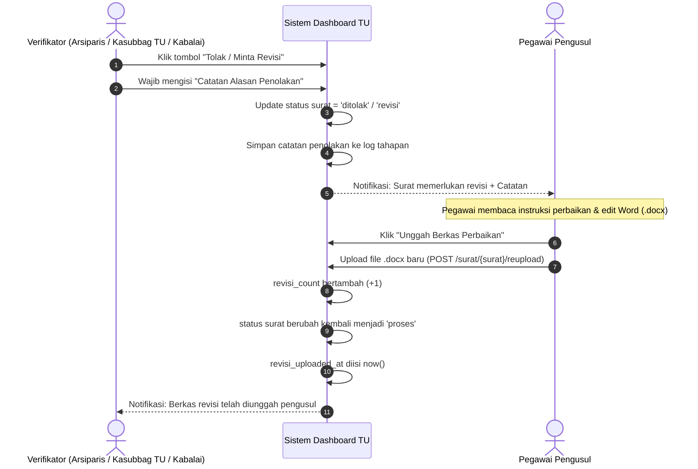

# 🛠️ Mekanisme Revisi & Penolakan Naskah Dinas
### Sistem Informasi Dashboard TU BP SUML

Dokumen ini mendokumentasikan tata kelola penolakan surat, pencatatan instruksi perbaikan oleh verifikator, alur pengunggahan berkas perbaikan oleh pegawai, serta penanganan revisi administratif.

---

## 1. Alur Penolakan & Pengembalian Naskah

Apabila dalam proses verifikasi (pada Tahap 2, 3, atau 4) ditemukan naskah yang tidak memenuhi syarat:



---

## 2. Parameter dan Atribut Model Terkait Revisi

Pada tabel `surats`, atribut berikut digunakan untuk mengelola siklus revisi:
- **`status`**: Bernilai `'ditolak'` saat verifikator menolak naskah, atau `'revisi'` saat dalam proses pengerjaan koreksi oleh pegawai.
- **`status_revisi`** (boolean): Bernilai `true` jika naskah ini pernah atau sedang mengalami koreksi.
- **`revisi_count`** (integer): Jumlah total iterasi revisi yang dilakukan oleh pegawai (mulai dari 0).
- **`revisi_uploaded_at`** (datetime): Timestamp saat dokumen perbaikan terakhir kali diunggah oleh pengusul.

Pada model `Surat`, tersedia method pembantu:
```php
public function bisaRevisi(): bool
{
    return $this->status === 'ditolak';
}

public function sedangRevisi(): bool
{
    return $this->status === 'revisi';
}
```

---

## 3. Prioritas Pengurutan Antrean (*Priority Sorting*)

Naskah yang baru saja diperbaiki oleh pengusul memerlukan telaah cepat agar tidak mengorbankan SLA. Oleh karena itu, pada antrean admin (`SuratController::index`), surat yang berstatus revisi ditempatkan di posisi teratas:

```php
// Naskah berstatus 'revisi' atau 'revisi_admin' diprioritaskan di atas
$query->orderByRaw("CASE WHEN status = 'revisi' OR status = 'revisi_admin' THEN 0 ELSE 1 END")
      ->latest();
```

---

## 4. Unggah Ulang Berkas oleh Admin (`uploadFileAdmin`)

Selain pegawai pengusul, verifikator/admin juga memiliki fasilitas mengunggah berkas pengganti langsung melalui rute:
- `POST /Admin/Surat/{surat}/upload-file-admin`

Fitur ini sangat berguna apabila verifikator hanya perlu melakukan perbaikan tipografi kecil (misal: membetulkan tanda baca atau spasi) tanpa perlu mengembalikan surat ke pegawai, sehingga mempercepat alur birokrasi kedinasan.

