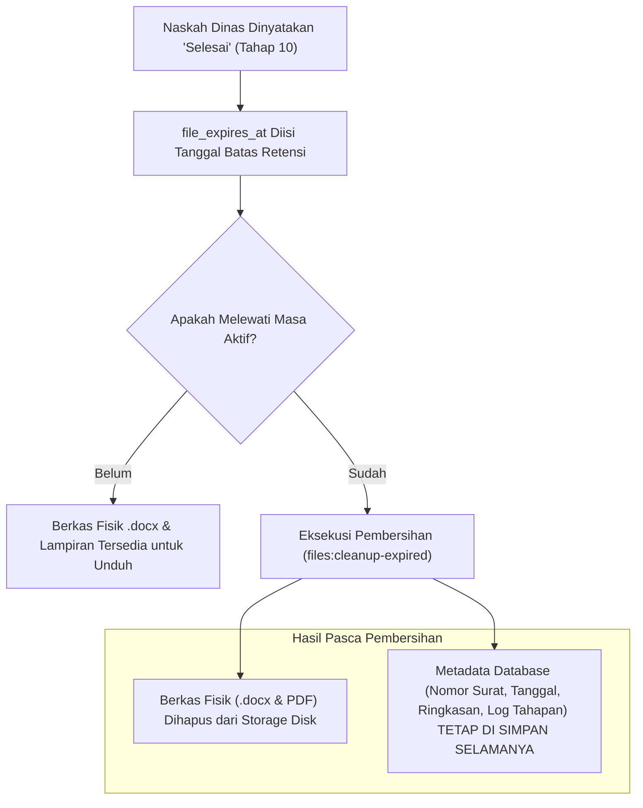

# 🗄️ Retensi Berkas & Pembersihan Penyimpanan (Purge)
### Sistem Informasi Dashboard TU BP SUML

Dokumen ini menjelaskan strategi manajemen ruang penyimpanan (*disk storage*), kebijakan masa aktif berkas fisik (`file_expires_at`), pembersihan otomatis via cron, dan pembedaan antara berkas fisik versus metadata permanen database.

---

## 1. Filosofi Retensi Data: Metadata Permanen vs Berkas Fisik

Server on-premise kantor memiliki kapasitas harddisk yang terbatas. Jika seluruh file Microsoft Word (`.docx`) dan lampiran lampau dibiarkan menumpuk bertahun-tahun, server dapat kehabisan kapasitas *storage* (*disk space exhaustion*).

Untuk mengatasi kendala ini, sistem menerapkan arsitektur penyimpanan bertingkat:

---

## 2. Kolom Manajemen Berkas pada Tabel `surats`

- **`file_word`**: Path direktori berkas utama Microsoft Word di `storage/app/private/surat/`.
- **`file_lampiran`**: Path direktori berkas pendukung (PDF/ZIP) di `storage/app/private/lampiran/`.
- **`file_expires_at`**: Timestamp tanggal kedaluwarsa berkas fisik. Diisi secara otomatis saat surat tuntas melewati Tahap 10.
- **`file_dihapus_pada`**: Timestamp pencatatan saat berkas fisik dihapus dari disk server.

---

## 3. Fitur Pembersihan Fisik Mandiri (*Manual Purge*)

Selain automasi jadwal malam, sistem menyediakan dua antarmuka pembersihan berkas fisik langsung:

1. **Purge oleh Pengusul / Admin per Surat**:
   - Rute: `POST /surat/{surat}/purge-files`
   - Pengusul atau verifikator dapat menekan tombol *"Bersihkan Berkas Fisik"* pada halaman detail surat yang sudah selesai untuk langsung mengosongkan storage tanpa menunggu tanggal kedaluwarsa.
2. **Manajemen Berkas Massal oleh Admin** (`/Admin/Settings/File-Surat`):
   - Admin dapat melihat daftar seluruh surat yang masih menyimpan berkas fisik.
   - Tersedia tombol **Hapus Massal** (`POST /Admin/Settings/File-Surat/mass-delete`) untuk membebaskan ruang harddisk secara instan dalam skala besar.
   - Surat yang berkasnya telah dihapus ditandai dengan label *"Berkas Telah Dibersihkan"*, tetapi nomor surat, log verifikator, dan isi ringkasannya tetap dapat dilihat untuk keperluan arsip sejarah.

