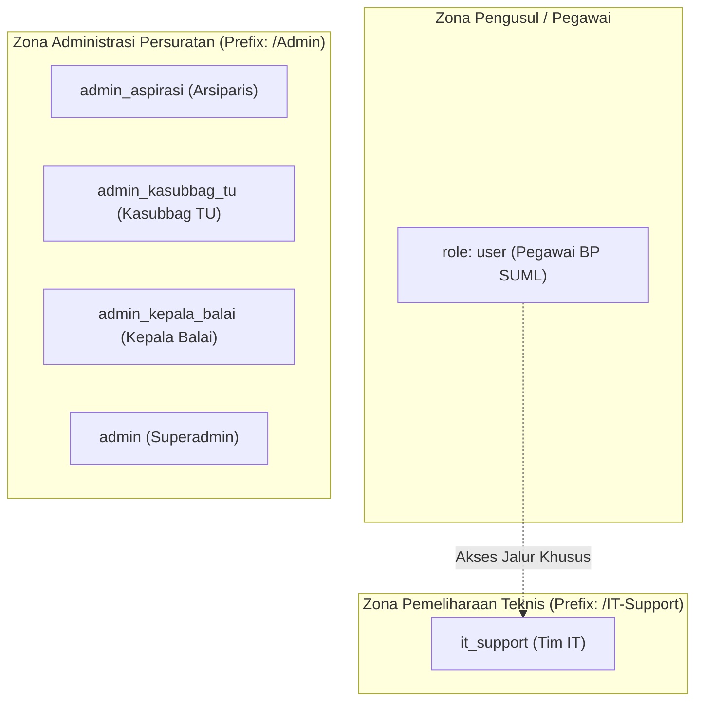

# 👥 Definisi & Hierarki Peran Pengguna (User Roles)
### Sistem Informasi Dashboard TU BP SUML

Dokumen ini mendefinisikan seluruh peran pengguna (*user roles*), klasifikasi tanggung jawab fungsional, dan pemisahan wewenang operasional di lingkungan BP SUML.

---

## 1. Daftar 6 Peran Utama Sistem

Basis data mendefinisikan 6 nilai peran pada enum `role` di tabel `users`:

| Kode Role (`role`) | Nama Peran / Jabatan | Kategori | Ringkasan Tugas & Tanggung Jawab |
|---|---|---|---|
| `user` | **Pegawai Pengusul** | Pemohon Layanan | Pegawai internal kantor BP SUML yang menyusun draf naskah dinas, mengajukan surat, melacak progres tahapan, mengunggah revisi, dan memberikan penilaian (rating) layanan. |
| `admin_aspirasi` | **Arsiparis** | Verifikator Fungsional | Memeriksa format tata naskah dinas (Tahap 2), menginput nomor surat resmi (Tahap 5), mendistribusikan TNDe/Srikandi (Tahap 7 & 8), dan melakukan pengarsipan akhir (Tahap 9). |
| `admin_kasubbag_tu` | **Kasubbag Tata Usaha** | Manajerial & Personalia | Verifikator administratif dan substansi kedinasan (Tahap 3), pengelolaan akun pegawai, persetujuan penghapusan surat, dan eksekutor **Reset Password Mandiri**. |
| `admin_kepala_balai` | **Kepala Balai** | Pimpinan Puncak | Mengambil keputusan persetujuan akhir naskah dinas (Tahap 4) dan membubuhkan Tanda Tangan Elektronik resmi (Tahap 6 TTE) menggunakan PIN privat. |
| `it_support` | **Tim Bantuan Teknis IT** | Pemelihara Sistem | Mengelola tiket kendala teknis (bug reporting), memantau log error aplikasi, dan mengirimkan siaran pengumuman (*broadcast system notifications*). |
| `admin` | **Superadmin (Legacy)** | Pengelola Sistem | Peran tingkat sistem tertinggi warisan awal yang memiliki hak akses menyeluruh ke seluruh modul dan bypass tahapan verifikasi. |

---

## 2. Pengelompokan Tingkat Otoritas

Sistem membedakan pengguna ke dalam 3 zona akses:

1. **Grup Admin**:
   - Dicek melalui method helper `User::isAdmin()`.
   - Mengembalikan nilai `true` untuk: `['admin', 'admin_aspirasi', 'admin_kasubbag_tu', 'admin_kepala_balai']`.
   - Dilindungi oleh middleware `admin` dan `admin.role.check`.
2. **Grup IT Support**:
   - Dicek melalui method helper `User::isITSupport()`.
   - Dilindungi oleh middleware `EnsureIsITSupport` pada prefix `/IT-Support`.
3. **Grup Pengguna Standar**:
   - Mengakses panel pengusul di `/dashboard`, `/surat`, `/aspirasi`, `/agenda`, dll.

