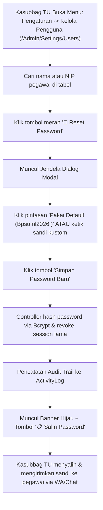

# 🔑 Otoritas Khusus Kasubbag Tata Usaha
### Sistem Informasi Dashboard TU BP SUML

Dokumen ini mendokumentasikan wewenang khusus Kasubbag TU (`admin_kasubbag_tu`), latar belakang arsitektur fitur **Reset Password Mandiri**, tata kelola persetujuan penghapusan naskah, serta manajemen akun aparatur.

---

## 1. Fitur Reset Password Pegawai Mandiri (Mitigasi LAN Tanpa SMTP)

### A. Latar Belakang Masalah Jaringan Kantor
Di server instansi BP SUML yang berada dalam perimeter Intranet kantor:
- Seluruh port surat elektronik keluar (port SMTP 25, 465, 587) diblokir oleh kebijakan keamanan firewall instansi.
- Akibatnya, pengiriman link token melalui fitur bawaan Laravel *"Lupa Kata Sandi"* selalu mengalami kegagalan (*Connection timed out*).
- Jika seorang pegawai lupa kata sandinya, mereka tidak dapat mereset akun secara mandiri lewat kotak masuk email.

### B. Solusi Desain Sistem
Kasubbag TU (`admin_kasubbag_tu`) dan Superadmin (`admin`) dibekali otoritas administratif untuk melakukan reset kata sandi pegawai secara langsung melalui antarmuka web:

### C. Keamanan & Audit Penyetelan Ulang
1. **Hashing Standar Industri**: Kata sandi baru di-hash menggunakan algoritma Bcrypt sebelum ditulis ke tabel `users`.
2. **Pencatatan Audit Otomatis**: Setiap aksi reset terekam di tabel `activity_logs` lengkap dengan nama pegawai penerima dan timestamp eksekusi.
3. **Pencabutan Sesi Lama**: Sesi login lama di perangkat lain otomatis dinonaktifkan demi mencegah pembajakan akun.

---

## 2. Otoritas Persetujuan Penghapusan Naskah (`SuratDeleteRequest`)

Pegawai pengusul tidak diizinkan menghapus surat yang telah diajukan secara sepihak untuk mencegah penghilangan barang bukti naskah kedinasan:
1. Pegawai hanya dapat mengajukan permohonan (*request delete*) disertai alasan resmi pembatalan.
2. Naskah berstatus pending delete masuk ke meja Kasubbag TU.
3. Kasubbag TU dapat:
   - **Menyetujui Penghapusan** (`POST /Admin/Surat/delete-request/{deleteRequest}/approve`): Naskah dihapus atau dipindahkan ke arsip batal.
   - **Menolak Permohonan** (`POST /Admin/Surat/delete-request/{deleteRequest}/reject`): Surat tetap berlanjut dalam alur verifikasi resmi.

---

## 3. Manajemen Akun Pegawai & Pengubahan Peran

Kasubbag TU memiliki wewenang penuh pada modul `/Admin/Settings/Users`:
- Mendaftarkan akun pegawai baru.
- Menyesuaikan NIP dan alamat email resmi.
- Memperbarui peran pegawai (misal: mempromosikan pegawai menjadi Arsiparis atau IT Support).
- Menonaktifkan akun pegawai yang telah mutasi atau purna tugas.

