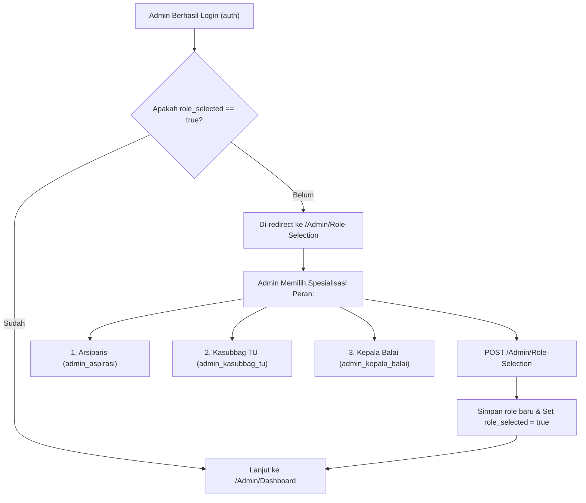

# 🔀 Pemilihan Peran & Alih Akun (Switch Account)
### Sistem Informasi Dashboard TU BP SUML

Dokumen ini mendokumentasikan alur seleksi peran admin (*Role Selection*), gerbang middleware `admin.role.check`, serta mekanisme alih akun instan berbasis token (*token-based switch account*).

---

## 1. Alur Pemilihan Peran Admin (Role Selection Gate)

### A. Latar Belakang Desain
Sebagian pejabat administrasi di BP SUML memiliki penugasan ganda atau baru saja dipromosikan ke jajaran tata usaha. Untuk mencegah akses tanpa penegasan peran yang jelas:
- Akun berstatus admin yang belum memilih peran spesifik (`role_selected = false`) dicegat oleh middleware.



### B. Implementasi Middleware `RedirectIfAdminRoleNotSelected`
```php
public function handle(Request $request, Closure $next)
{
    $user = $request->user();

    if ($user && $user->isAdmin() && !$user->hasSelectedRole()) {
        if (!$request->routeIs('admin.role.select') && !$request->routeIs('admin.role.store')) {
            return redirect()->route('admin.role.select');
        }
    }

    return $next($request);
}
```

---

## 2. Mekanisme Alih Akun Berbasis Token (Switch Account)

Untuk kebutuhan pengujian, simulasi verifikasi multi-level antar pejabat, atau pendampingan operasional staf:
- Disediakan modul alih akun instan tanpa memerlukan masukan ulang kata sandi melalui `SwitchAccountController`.

### A. Rute & Batasan Keamanan
- **Rute**: `POST /auth/switch-account`
- **Nama Rute**: `auth.switch`
- **Rate Limit**: Dilindungi oleh `throttle:10,1` (maksimal 10 perpindahan akun per menit).
- **Mekanisme**:
  1. Pengguna meminta token pergantian akun yang aman.
  2. Sistem menghasilkan token acak pada kolom `switch_token` dengan batas waktu kedaluwarsa singkat pada kolom `switch_token_expires_at`.
  3. Setelah token diverifikasi, `Auth::loginUsingId($targetUser->id)` dieksekusi dan token langsung dihanguskan (*single-use token*).
  4. Seluruh aktivitas perpindahan akun dicatat ke dalam `activity_logs`.

