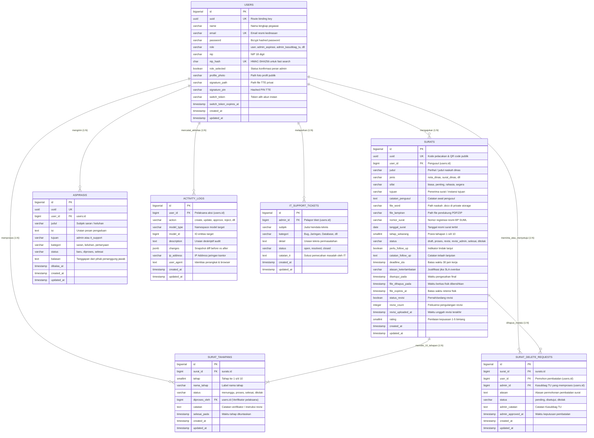

# 🗄️ Diagram Relasi Entitas (Entity-Relationship Diagram)
### Sistem Informasi Dashboard TU BP SUML

Dokumen ini menyajikan gambaran visual menyeluruh mengenai struktur relasi antar tabel basis data **PostgreSQL** yang menopang seluruh operasional **Dashboard TU BP SUML**.

---

## 1. Diagram Relasi Entitas Komprehensif (ERD)

---

## 2. Karakteristik Basis Data PostgreSQL yang Digunakan

1. **Foreign Key Constraints**: Menjaga konsistensi relasional (misal: saat surat dihapus atau direferensikan).
2. **Kolom Tipe JSONB**: Kolom `changes` pada tabel `activity_logs` menggunakan tipe data native `jsonb` PostgreSQL yang mendukung query indeks internal dan penghematan ruang penyimpanan.
3. **B-Tree & Hash Indexing**:
   - Kolom `nip_hash` diindeks khusus untuk pencarian instan bernilai konstan $O(1)$.
   - Kolom `uuid` diindeks unik (*unique key*) sebagai kunci rute publik tanpa mengekspos identifier primary key (`id`).

