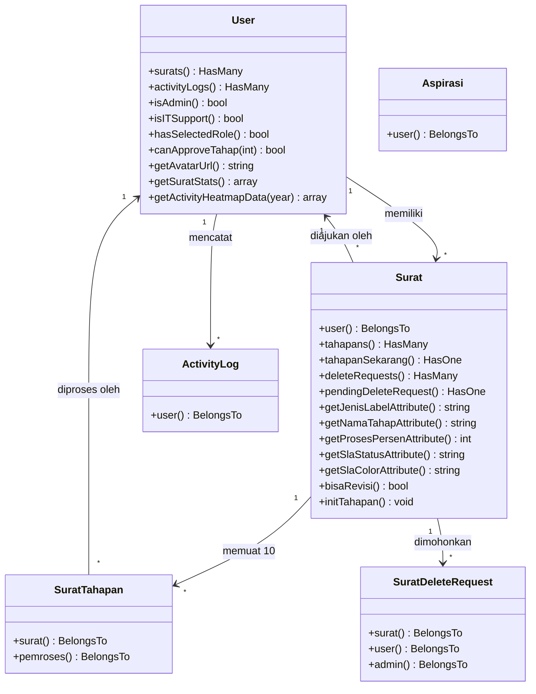

# 🧩 Model Eloquent & Relasi Antar Objek
### Sistem Informasi Dashboard TU BP SUML

Dokumen ini mendokumentasikan implementasi kelas model Eloquent ORM, relasi antar entitas, *casting* tipe data atribut, *lifecycle hooks*, serta method pembantu (*accessor & helper methods*).

---

## 1. Peta Relasi Antar Model Eloquent



---

## 2. Fitur Khusus pada Model `Surat`

### A. Route Key Binding Menggunakan UUID
```php
public function getRouteKeyName()
{
    return 'uuid';
}
```
Memastikan seluruh URL publik dan internal menggunakan UUID (misal: `/surat/c8d19f52-4e09-4d37-975d-318e47bcf308`), sehingga primary key integer tidak bocor ke publik.

### B. Inisialisasi 10 Tahapan Otomatis
```php
public function initTahapan(): void
{
    foreach (self::NAMA_TAHAP as $tahap => $nama) {
        $this->tahapans()->create([
            'tahap' => $tahap,
            'nama_tahap' => $nama,
            'status' => $tahap === 1 ? 'selesai' : 'menunggu',
        ]);
    }
}
```

### C. Accessor Perhitungan SLA & Progress Bar
- **`proses_persen`**: `round(($this->tahap_sekarang / 10) * 100)` &rarr; Menghasilkan persentase bilah progres 10% s/d 100%.
- **`sla_status`**: Membandingkan `now()` dengan `deadline_sla`. Mengembalikan `'terlambat'` jika waktu telah terlampaui.
- **`sisa_jam`**: Menghitung selisih menit dan jam tersisa secara presisi (`Xj Ym`).

---

## 3. Fitur Khusus pada Model `User`

### A. Pengindeksan Deterministik NIP Hash
- `User::hashNip($nip)`: Menggunakan `hash_hmac('sha256', $nip, config('app.key'))`.
- `User::findByNip($nip)`: Mencari baris user secara instan melalui kolom `nip_hash`.

### B. Analitik Heatmap Pegawai & Admin
- `getActivityHeatmapData($year)`: Mengagregasi jumlah pengajuan surat dan unggah revisi harian per tahun untuk grafik kalender kontribusi pegawai mirip GitHub commit heatmap.
- `getAdminActivityHeatmapData($year)`: Mengagregasi frekuensi persetujuan/verifikasi surat yang dilakukan admin sepanjang tahun berjalan.

