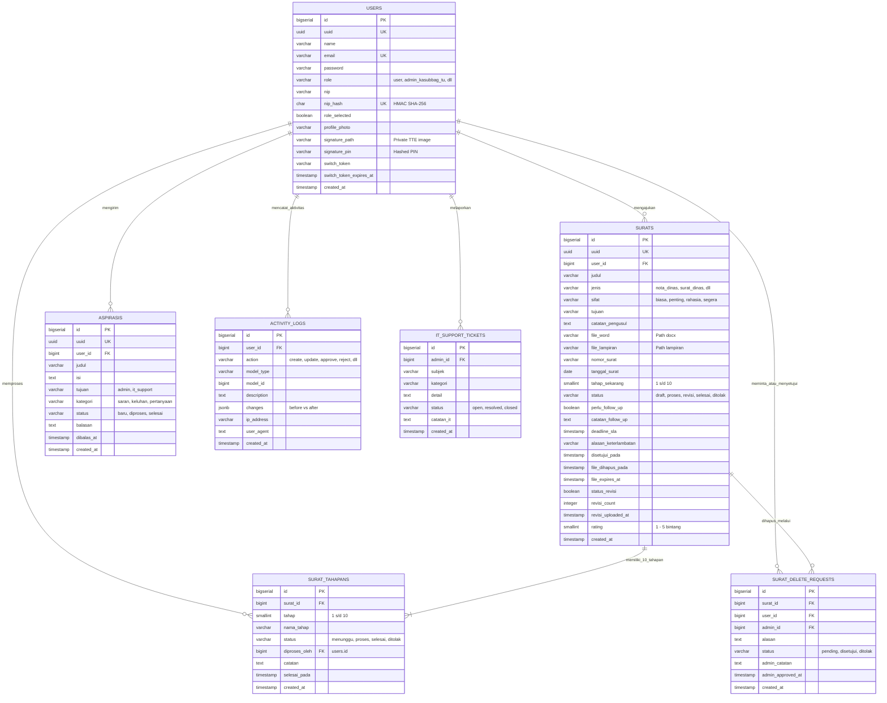

# 🗄️ Modul 04: Basis Data & Skema Model (ERD)
### Sistem Informasi Dashboard TU BP SUML

Dokumen ini menyediakan spesifikasi basis data komprehensif berbasis **PostgreSQL**, diagram relasi antar tabel (*Entity-Relationship Diagram*), serta kamus data untuk seluruh entitas sistem.

---

## 1. Diagram Relasi Entitas (ERD)

---

## 2. Kamus Data Entitas Utama

### A. Tabel `users`
Menyimpan identitas seluruh pemangku kepentingan (pegawai dan pejabat administrasi):

| Kolom | Tipe Data | Keterangan & Aturan Bisnis |
|---|---|---|
| `id` | `BIGINT UNSIGNED` (Auto-increment, PK) | Identifier primer tabel. |
| `uuid` | `CHAR(36)` (Unique Index) | Identifier publik untuk rute URL aman (*Route Key Name*). |
| `name` | `VARCHAR(255)` | Nama lengkap pegawai dan gelar. |
| `email` | `VARCHAR(255)` (Unique Index) | Alamat email resmi pegawai. |
| `password` | `VARCHAR(255)` | Hash kata sandi menggunakan algoritma Bcrypt. |
| `role` | `ENUM` | Nilai: `user`, `admin_aspirasi`, `admin_kasubbag_tu`, `admin_kepala_balai`, `it_support`, `admin`. |
| `nip` | `VARCHAR(50)` (Nullable) | NIP pegawai (18 digit angka standar BKN). |
| `nip_hash` | `CHAR(64)` (Unique, Nullable) | Hash HMAC-SHA256 dari NIP untuk keperluan pencarian login cepat tanpa mengekspos NIP asli. |
| `signature_path`| `VARCHAR(255)` (Nullable) | Lokasi penyimpanan berkas scan tanda tangan privat di disk server. |
| `signature_pin` | `VARCHAR(255)` (Nullable) | Hash PIN keamanan pembubuhan tanda tangan elektronik (TTE). |
| `profile_photo` | `VARCHAR(255)` (Nullable) | Lokasi foto avatar profil pegawai. |

---

### B. Tabel `surats`
Pusat metadata transaksi naskah dinas kedinasan:

| Kolom | Tipe Data | Keterangan & Aturan Bisnis |
|---|---|---|
| `id` | `BIGINT UNSIGNED` (PK) | Identifier primer internal database. |
| `uuid` | `CHAR(36)` (Unique Index) | Identifier publik naskah untuk pelacakan dan kode QR (`/v/{uuid}`). |
| `user_id` | `BIGINT UNSIGNED` (FK -> `users.id`) | Pegawai pembuat/pengusul naskah dinas. |
| `judul` | `VARCHAR(255)` | Perihal / ringkasan isi surat. |
| `jenis` | `ENUM` | `nota_dinas`, `surat_dinas`, `surat_keputusan`, `surat_pernyataan`, `surat_keterangan`, `surat_undangan`, `surat_lainnya`. |
| `sifat` | `ENUM` | Tingkat urgensi: `biasa`, `penting`, `rahasia`, `segera`. |
| `tujuan` | `VARCHAR(255)` | Pihak atau instansi penerima surat. |
| `tahap_sekarang` | `TINYINT UNSIGNED` (Default: 1) | Posisi tahapan saat ini (angka 1 sampai 10). |
| `status` | `ENUM` | `draft`, `proses`, `revisi`, `revisi_admin`, `selesai`, `ditolak`. |
| `deadline_sla` | `DATETIME` (Nullable) | Target batas waktu penyelesaian berdasarkan jam kerja aktif (30 jam). |
| `alasan_keterlambatan` | `VARCHAR(255)` (Nullable) | Keterangan justifikasi jika pemrosesan melewati `deadline_sla`. |
| `file_word` | `VARCHAR(255)` (Nullable) | Lokasi berkas fisik utama format Microsoft Word (`.docx`). |
| `file_lampiran`| `VARCHAR(255)` (Nullable) | Lokasi berkas pendukung (PDF/ZIP). |
| `file_expires_at` | `DATETIME` (Nullable) | Waktu kedaluwarsa berkas fisik untuk pembersihan otomatis. |
| `revisi_count` | `INT UNSIGNED` (Default: 0) | Akumulasi frekuensi revisi yang telah dilakukan. |
| `rating` | `TINYINT UNSIGNED` (Nullable) | Indeks kepuasan pengguna (1 s/d 5) yang diisi pasca surat selesai. |

---

### C. Tabel `surat_tahapans`
Riwayat kronologis pemrosesan 10 tahapan per surat:

| Kolom | Tipe Data | Keterangan & Aturan Bisnis |
|---|---|---|
| `id` | `BIGINT UNSIGNED` (PK) | Identifier log tahapan. |
| `surat_id` | `BIGINT UNSIGNED` (FK -> `surats.id`) | Naskah dinas terkait. |
| `tahap` | `TINYINT UNSIGNED` | Nomor tahapan (1 sampai 10). |
| `nama_tahap` | `VARCHAR(100)` | Deskripsi nama tahapan (misal: "Verifikasi Arsiparis"). |
| `status` | `ENUM` | Nilai: `menunggu`, `proses`, `selesai`, `ditolak`. |
| `diproses_oleh`| `BIGINT UNSIGNED` (FK -> `users.id`) | Pejabat/Admin yang mengeksekusi tahapan tersebut. |
| `catatan` | `TEXT` (Nullable) | Catatan verifikator, instruksi perbaikan, atau nomor agenda. |
| `selesai_pada` | `DATETIME` (Nullable) | Timestamp saat tahapan tersebut dituntaskan. |

---

### D. Tabel `activity_logs`
Audit trail seluruh aktivitas sistem:

| Kolom | Tipe Data | Keterangan & Aturan Bisnis |
|---|---|---|
| `id` | `BIGINT UNSIGNED` (PK) | Identifier log aktivitas. |
| `user_id` | `BIGINT UNSIGNED` (FK -> `users.id`) | Aktor yang melakukan aksi. |
| `action` | `VARCHAR(50)` | Jenis tindakan (`create`, `update`, `approve`, `reject`, `download`, `reset_password`). |
| `model_type` | `VARCHAR(100)` (Nullable) | Nama kelas model yang disentuh (misal: `App\Models\Surat`). |
| `model_id` | `BIGINT UNSIGNED` (Nullable) | ID baris data yang disentuh. |
| `description` | `TEXT` | Narasi penjelasan aktivitas audit dalam bahasa manusia. |
| `changes` | `JSON` (Nullable) | Snapshot perubahan atribut kolom (*old vs new values*). |
| `ip_address` | `VARCHAR(45)` | Alamat IP jaringan lokal/publik aktor. |
| `user_agent` | `TEXT` | Identitas browser dan perangkat yang digunakan. |
