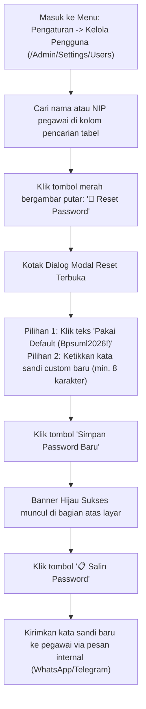

# 📋 Panduan Operasional Kasubbag Tata Usaha (`admin_kasubbag_tu`)
### Sistem Informasi Dashboard TU BP SUML

Dokumen ini merupakan panduan praktis bagi **Kepala Subbagian Tata Usaha (Kasubbag TU)** dalam memverifikasi substansi administrasi persuratan (Tahap 3), mengelola akun pegawai, mengeksekusi fitur darurat **Reset Password Pegawai**, serta meninjau permohonan pembatalan naskah dinas.

---

## 1. Verifikasi Administratif & Substansi Kedinasan (Tahap 3)

Setelah naskah lolos pemeriksaan format oleh Arsiparis:

1. Buka antrean tugas di `/Admin/Surat` atau klik menu **"Surat Masuk"**.
2. Surat yang berada di **Tahap 3 (Verifikasi Kasubbag TU)** akan ditampilkan.
3. Klik tombol **Periksa Naskah**:
   - Telaah urgensi dan esensi surat kedinasan: apakah relevan dengan tupoksi balai, apakah pembebanan anggaran/tugas telah sesuai, dan periksa apakah ada disposisi yang mendasari.
4. Tentukan keputusan:
   - **Setujui Naskah**: Klik tombol **"Setujui & Teruskan ke Kepala Balai"**. Naskah berpindah ke **Tahap 4 (Persetujuan Kepala Balai)**.
   - **Tolak / Minta Revisi**: Klik tombol merah **"Tolak / Revisi"**, isi catatan arahan perbaikan (misal: *"Perbaiki konsiderans menimbang poin b"*).

---

## 2. Panduan Eksekusi: Reset Kata Sandi Pegawai Mandiri

Gunakan panduan ini saat ada pegawai yang lupa kata sandi dan link email konfirmasi tidak sampai akibat pemblokiran port SMTP jaringan intranet LAN kantor:

### Langkah Rinci:
1. Klik menu navigasi **Pengaturan** &rarr; **Kelola Pengguna** (`/Admin/Settings/Users`).
2. Gunakan kolom pencarian untuk menemukan pegawai yang mengajukan permohonan reset password.
3. Klik tombol **🔄 Reset Password** pada kolom *Aksi* di baris pegawai tersebut (atau buka profil detail pegawai dan klik tombol **🔄 Reset Password**).
4. Pada kotak dialog modal yang muncul:
   - Klik pintasan teks **"Pakai Default (Bpsuml2026!)"** untuk mengisi kata sandi standar kantor secara otomatis, atau ketikkan kata sandi baru sesuai permintaan pegawai.
   - Klik ikon mata (👁️) jika ingin melihat teks sandi yang diketik.
5. Klik tombol **"Simpan Password Baru"**.
6. Sistem akan mengenkripsi kata sandi baru ke basis data, mencabut sesi lama yang aktif, dan menampilkan kotak notifikasi hijau di bagian atas dengan tombol **📋 Salin Password**.
7. Klik tombol salin, lalu kirimkan kata sandi tersebut secara aman kepada pegawai yang bersangkutan.

---

## 3. Persetujuan Permohonan Hapus Surat (*Delete Request*)

Apabila seorang pegawai membatalkan pengajuan naskah dinas:
1. Permohonan masuk ke daftar permohonan pembatalan.
2. Kasubbag TU menelaah alasan pembatalan (misal: *"Agenda rapat dibatalkan oleh kementerian"*).
3. Kasubbag TU memberikan keputusan:
   - **Setujui Hapus**: Menyetujui surat dibatalkan/dihapus dari antrean aktif.
   - **Tolak Permohonan**: Mewajibkan surat tetap dilanjutkan.

---

## 4. Pemantauan Kepatuhan SLA & Analisis Beban Kerja

1. Buka menu **Laporan** (`/Admin/Laporan`) dan **SLA Persurat** (`/Admin/SLA-Persurat`).
2. Periksa grafik persentase kepatuhan terhadap target 30 jam kerja.
3. Identifikasi jika ada naskah berstatus merah (overdue) dan periksa alasan keterlambatan yang diinputkan oleh tim pelaksana.
4. Klik tombol **"Export Excel (.xlsx)"** untuk mengunduh rekapitulasi data sebagai bahan rapat evaluasi pimpinan.

