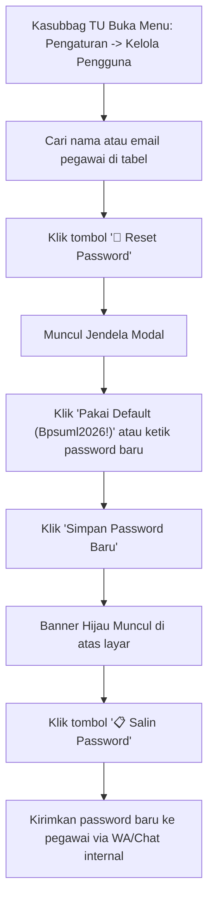

# 📖 Modul 05: Panduan Pengguna & Administrator
### Sistem Informasi Dashboard TU BP SUML

Dokumen ini merupakan petunjuk praktis operasional sistem baik bagi **Pegawai Pengusul** maupun pejabat **Administrator (Arsiparis, Kasubbag TU, dan Kepala Balai)**.

---

## BAGIAN I: PANDUAN PEGAWAI PENGUSUL (`user`)

### 1. Masuk ke Sistem (Login)
1. Buka peramban (*web browser*) dan arahkan ke alamat web instansi.
2. Klik tombol **"Masuk"** di sudut kanan atas.
3. Masukkan **Alamat Email Resmi** atau **NIP (18 Digit)** serta kata sandi akun Anda.
4. Klik **"Login"**. Anda akan diarahkan ke Dashboard Pegawai.

---

### 2. Mengajukan Naskah Dinas Baru
1. Pada menu navigasi sebelah kiri, klik **"Ajukan Surat"** (`/surat/ajukan`).
2. Lengkapi formulir pengusulan:
   - **Perihal / Judul Surat**: Tuliskan subjek naskah dinas secara ringkas dan jelas.
   - **Jenis Surat**: Pilih jenis naskah (misal: *Nota Dinas*, *Surat Dinas*, *Surat Undangan*).
   - **Sifat Surat**: Tentukan urgensi (*Biasa*, *Penting*, *Segera*, atau *Rahasia*).
   - **Tujuan Surat**: Instansi/unit kerja atau nama pejabat yang dituju.
   - **Catatan Pengusul**: Keterangan tambahan atau latar belakang pengajuan (opsional).
3. **Unggah Berkas**:
   - **Berkas Naskah (.docx)**: Unggah draf surat format Microsoft Word (maksimal 10 MB).
   - **Berkas Lampiran**: Unggah berkas pendukung format PDF atau ZIP jika ada (maksimal 20 MB).
4. Pilih salah satu tombol tindakan:
   - **"Simpan Draf"**: Jika Anda masih ingin menyunting naskah kembali nanti.
   - **"Kirim Pengajuan"**: Untuk langsung meneruskan naskah ke antrean verifikasi Arsiparis (Tahap 1 dimulai).

---

### 3. Memantau Status & SLA Surat
1. Buka menu **"Daftar Surat Saya"** (`/surat`).
2. Klik tombol **Detail / Pantau (👁️)** pada surat yang ingin dilacak.
3. Pada halaman detail:
   - **Bilah Progres (10 Tahap)**: Menampilkan posisi real-time naskah (misal: sedang di *Tahap 3: Verifikasi Kasubbag TU*).
   - **Indikator SLA**: Menampilkan sisa waktu penyelesaian.
     - 🟢 **Hijau**: Sisa waktu aman (> 12 jam kerja).
     - 🟡 **Kuning**: Waktu mendekati batas ($\le$ 12 jam kerja).
     - 🔴 **Merah**: Melewati batas waktu standar pelayanan.

---

### 4. Mengunggah Perbaikan Dokumen (Jika Ditolak/Revisi)
1. Jika status surat berubah menjadi **"Revisi / Ditolak"**, periksa kotak **Catatan Verifikator** berwarna merah di halaman detail surat.
2. Perbaiki dokumen Microsoft Word di komputer Anda sesuai instruksi verifikator.
3. Klik tombol **"Unggah Berkas Perbaikan"**.
4. Pilih file `.docx` baru yang telah diperbaiki, lalu klik **"Kirim Revisi"**.
5. Status surat akan kembali masuk ke antrean verifikasi secara otomatis.

---

### 5. Penyelesaian & Pemberian Rating
1. Setelah surat tuntas melewati Tahap 10, Anda dapat mengunduh **Dokumen Final Resmi** yang telah bernomor dan bertanda tangan.
2. Sistem akan menampilkan formulir kepuasan layanan: pilih jumlah **Bintang (1 s/d 5)** dan berikan testimoni singkat demi peningkatan mutu pelayanan tata usaha.

---

## BAGIAN II: PANDUAN ADMINISTRATOR & VERIFIKATOR

### 1. Dashboard Admin & Antrean Surat Masuk
1. Login menggunakan akun pejabat/admin.
2. Dashboard menampilkan ringkasan metrik:
   - Jumlah Surat Masuk Baru
   - Surat Sedang Diproses
   - Surat Memerlukan Tindak Lanjut
   - Pemenuhan SLA Keseluruhan
3. Klik menu **"Surat Masuk"** atau **"Surat Proses"** untuk melihat daftar antrean.

---

### 2. Memproses & Memberikan Keputusan Verifikasi
1. Buka naskah surat yang akan diperiksa.
2. Anda dapat melihat pratinjau dokumen Word langsung di peramban atau mengunduhnya.
3. Tentukan keputusan:
   - **Setujui & Lanjutkan**: Klik tombol hijau **"Setujui Tahap Ini"**. Tahapan surat akan bergeser ke tahap berikutnya.
   - **Tolak / Minta Revisi**: Klik tombol merah **"Tolak / Revisi"**, lalu **wajib ketikkan catatan perbaikan** secara spesifik agar pengusul memahami poin koreksinya.

---

### 3. Penomoran Surat Resmi (Khusus Arsiparis / Admin)
1. Ketika surat berada pada **Tahap 5 (Penomoran Surat)**:
2. Inputkan **Nomor Surat Resmi** (sesuai format penomoran BP SUML) dan tentukan **Tanggal Resmi Surat**.
3. Klik **"Simpan & Lanjutkan ke Tanda Tangan"**.

---

### 4. Pembubuhan Tanda Tangan Elektronik (Khusus Kepala Balai)
1. Pada **Tahap 6 (Tanda Tangan DS)**:
2. Kepala Balai meninjau lembar naskah akhir.
3. Masukkan **PIN Keamanan TTE** (6 digit yang telah didaftarkan pada profil Kepala Balai).
4. Klik **"Bubuhkan TTE & Sahkan"**. Sistem akan merekatkan tanda tangan digital dan menerbitkan QR Code otentikasi.

---

### 5. Ekspor Rekapitulasi Laporan Excel
1. Masuk ke menu **Laporan** (`/Admin/Laporan`).
2. Tentukan filter rentang tanggal pengajuan atau jenis surat.
3. Klik tombol **"Export Excel (.xlsx)"** untuk mengunduh rekapitulasi lengkap berisi nomor surat, pengusul, durasi pemrosesan tiap tahap, dan kepatuhan SLA.

---

## BAGIAN III: PANDUAN KHUSUS KASUBBAG TU: RESET PASSWORD PEGAWAI

Gunakan fitur ini apabila ada pegawai yang lupa kata sandi dan email konfirmasi tidak sampai akibat pemblokiran port SMTP jaringan LAN kantor:

1. Masuk ke menu **Pengaturan** &rarr; **Kelola Pengguna** (`/Admin/Settings/Users`).
2. Cari pegawai yang bersangkutan pada tabel data pegawai.
3. Klik tombol aksi **🔄 (Reset Password)** berwarna merah pada baris pegawai tersebut (atau buka halaman detail pegawai dan klik tombol **🔄 Reset Password** di samping tombol *Kembali*).
4. Pada kotak dialog yang muncul:
   - Anda dapat mengklik teks pintasan **"Pakai Default (Bpsuml2026!)"** untuk mengisi kata sandi standar kantor secara instan, **atau** ketikkan kata sandi custom baru (minimal 8 karakter).
   - Klik ikon 👁️ untuk memastikan penulisan kata sandi sudah benar.
5. Klik **"Simpan Password Baru"**.
6. Halaman akan menampilkan banner notifikasi hijau dengan teks sandi baru dan tombol **📋 Salin Password**.
7. Klik tombol tersebut untuk menyalin ke *clipboard*, lalu kirimkan kata sandi baru kepada pegawai yang bersangkutan.
8. Sarankan pegawai untuk segera mengganti kata sandi tersebut melalui menu **Profil Pribadi** setelah berhasil login.
