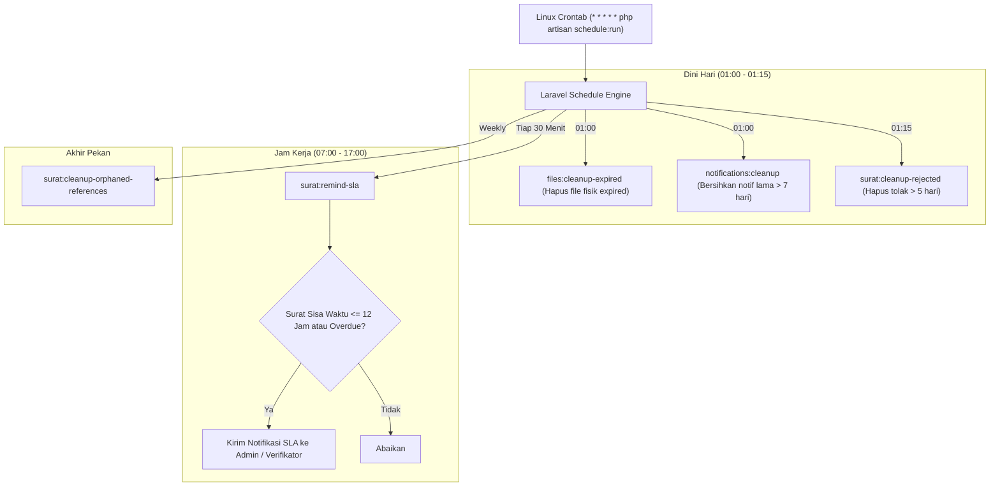

# ⏱️ Modul 06: Automasi & Background Scheduler (Cron)
### Sistem Informasi Dashboard TU BP SUML

Dokumen ini menjelaskan seluruh tugas latar belakang (*background tasks*), automasi pembersihan penyimpanan, dan penjadwalan (*Laravel Scheduler*) yang berjalan di server.

---

## 1. Daftar Perintah Artisan Terjadwal (Scheduled Commands)

Sistem mengonfigurasi serangkaian tugas pemeliharaan otomatis di `routes/console.php` yang dieksekusi secara berkala tanpa memerlukan intervensi manual:

| No | Perintah Artisan | Frekuensi / Waktu Eksekusi | Deskripsi & Tujuan |
|---|---|---|---|
| 1 | `files:cleanup-expired` | **Setiap hari pukul 01:00** | Menghapus berkas fisik Word (`.docx`) dan berkas lampiran yang naskahnya telah berstatus `selesai` dan melewati batas tanggal retensi (`file_expires_at`). Menghemat ruang penyimpanan server. |
| 2 | `notifications:cleanup` | **Setiap hari pukul 01:00** | Menghapus rekaman notifikasi sistem yang telah dibaca dan berusia lebih dari 7 hari agar tabel `notifications` tetap ringan. |
| 3 | `surat:cleanup-rejected` | **Setiap hari pukul 01:15** | Mengarsipkan atau membersihkan surat berstatus `ditolak` yang diabaikan dan tidak diperbaiki oleh pengusul selama lebih dari 5 hari kerja berturut-turut. |
| 4 | `surat:cleanup-orphaned-references` | **Mingguan (Weekly)** | Memeriksa integritas berkas di storage; jika terdapat entri jalur file di database tetapi berkas fisiknya sudah tidak ada di disk (berkas yatim), referensi tersebut dibersihkan. |
| 5 | `surat:remind-sla` | **Setiap 30 Menit (Jam Kerja: Sen–Jum, 07:00–17:00)** | Memeriksa naskah dinas yang sedang diproses. Jika waktu tersisa mendekati batas ($\le$ 12 jam) atau telah melewati deadline SLA, sistem secara otomatis membunyikan notifikasi peringatan ke dasbor verifikator. |

---

## 2. Diagram Alur Kerja Pemeliharaan Terjadwal



---

## 3. Konfigurasi Crontab di Ubuntu Server Linux

Agar seluruh automasi di atas berjalan otomatis, server Linux wajib memiliki baris cron scheduler Laravel.

### A. Membuka Editor Crontab
Jalankan perintah berikut di terminal server (gunakan user web server, misal `www-data` atau user deployer Anda):

```bash
crontab -e
```

### B. Menambahkan Konfigurasi Scheduler
Tambahkan baris berikut di baris paling bawah berkas:

```cron
* * * * * cd /var/www/dashboard-tubpsuml && php artisan schedule:run >> /dev/null 2>&1
```
*(Sesuaikan `/var/www/dashboard-tubpsuml` dengan lokasi direktori proyek sesungguhnya di server).*

---

## 4. Perintah Pengujian & Verifikasi Manual

Untuk memastikan seluruh perintah scheduler terdaftar dan berfungsi dengan benar tanpa menunggu jam tengah malam:

### A. Melihat Daftar Jadwal Aktif
```bash
php artisan schedule:list
```
Perintah ini akan menampilkan tabel jadwal, waktu eksekusi berikutnya, serta status intervalnya.

### B. Menjalankan Tugas Secara Manual untuk Pengetesan
Anda dapat menguji eksekusi masing-masing perintah secara langsung:

```bash
# Menjalankan pembersihan file kadaluarsa sekarang
php artisan files:cleanup-expired

# Menjalankan pembersihan notifikasi lama
php artisan notifications:cleanup

# Menjalankan pengecekan SLA sekarang
php artisan surat:remind-sla
```
Jika tidak muncul error di terminal, maka automasi telah siap beroperasi secara optimal di lingkungan produksi.
