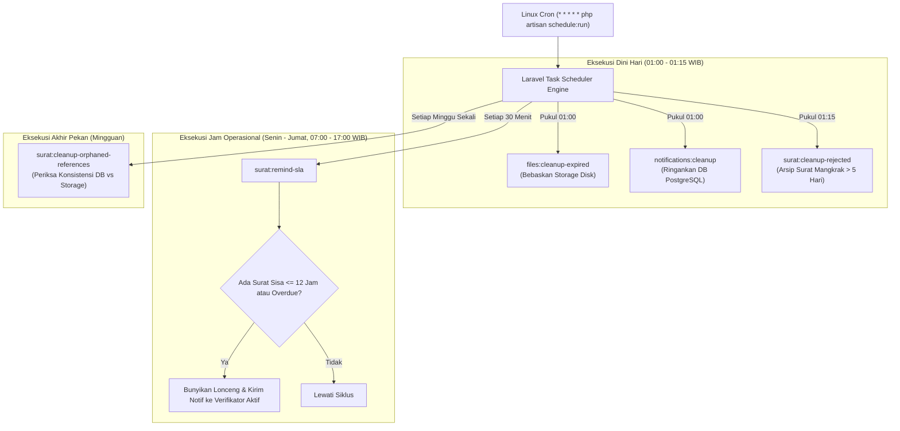

# ⏰ Jadwal & Frekuensi Eksekusi Background Tasks
### Sistem Informasi Dashboard TU BP SUML

Dokumen ini mendokumentasikan pemetaan jadwal penjadwalan otomatis (*Laravel Task Scheduling*) yang didefinisikan pada `routes/console.php`.

---

## 1. Pemetaan Jadwal pada `routes/console.php`

Framework Laravel 12 menyatukan seluruh konfigurasi penjadwalan pada berkas `routes/console.php`:

```php
<?php

use Illuminate\Support\Facades\Schedule;

// 1. Pembersihan berkas fisik kedaluwarsa — Setiap hari pukul 01:00 dini hari
Schedule::command('files:cleanup-expired')->dailyAt('01:00');

// 2. Pembersihan notifikasi lama (> 7 hari) — Setiap hari pukul 01:00 dini hari
Schedule::command('notifications:cleanup')->dailyAt('01:00');

// 3. Arsip naskah ditolak yang tidak direvisi > 5 hari — Setiap hari pukul 01:15 dini hari
Schedule::command('surat:cleanup-rejected')->dailyAt('01:15');

// 4. Sinkronisasi referensi berkas yatim di DB — Setiap akhir pekan (Mingguan)
Schedule::command('surat:cleanup-orphaned-references')->weekly();

// 5. Notifikasi pengingat SLA ke admin — Setiap 30 menit pada jam kerja aktif
//    Senin s/d Jumat, antara pukul 07:00 hingga 17:00 WIB
Schedule::command('surat:remind-sla')
    ->everyThirtyMinutes()
    ->weekdays()
    ->between('07:00', '17:00');
```

---

## 2. Diagram Alur Penjadwalan Berdasarkan Waktu



---

## 3. Strategi Efisiensi Beban Server

1. **Pemisahan Jam Sibuk & Jam Dini Hari**:
   - Tugas berat (menghapus file di disk, menghapus ribuan notifikasi lama, dan pemeriksaan integritas database) dieksekusi antara pukul **01:00 hingga 01:15 WIB**. Pada jam tersebut, tidak ada pegawai yang sedang menggunakan sistem.
2. **Kondisi Jam Kerja Ketat untuk Pengingat SLA**:
   - `surat:remind-sla` menggunakan constraint `weekdays()` dan `between('07:00', '17:00')`.
   - Menghemat query database karena server tidak perlu mengecek SLA di malam hari, hari Sabtu, atau hari Minggu saat kantor sedang libur.

